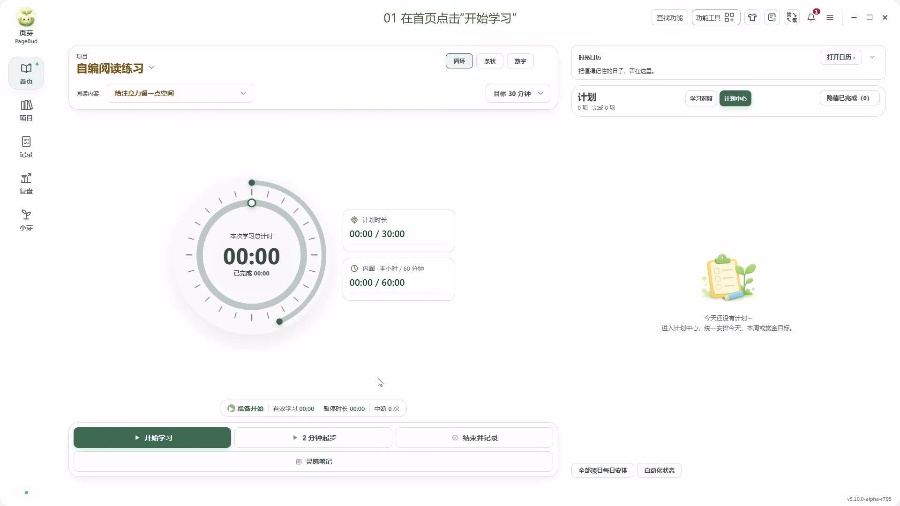

# 页芽 PageBud

页芽是一款 Windows 本地学习、规划、阅读与笔记工具。

个人发布者：nana  
联系邮箱：foxappleccc@gmail.com  
当前下载：5.10.0-alpha-r796 · Windows 64 位 · **未签名公开试用版（Pre-release）**

## 下载安装

**[下载独立安装包（Setup，约 1.03 GiB）](https://github.com/nanamiyananaa-code/PageBud-Downloads/releases/download/v5.10.0-alpha-r796/PageBud-Setup-5.10.0-alpha-r796-windows-x64.exe)** · [版本与全部附件](https://github.com/nanamiyananaa-code/PageBud-Downloads/releases/tag/v5.10.0-alpha-r796)

1. 首次使用下载 `PageBud-Setup-5.10.0-alpha-r796-windows-x64.exe`，运行安装向导。
2. 已有页芽的用户可选择 [升级包](https://github.com/nanamiyananaa-code/PageBud-Downloads/releases/download/v5.10.0-alpha-r796/PageBud-Update-5.10.0-alpha-r796-windows-x64.exe)；升级前确认数据已保存，并保留独立备份。
3. [SHA256SUMS.txt](https://github.com/nanamiyananaa-code/PageBud-Downloads/releases/download/v5.10.0-alpha-r796/SHA256SUMS.txt) 提供文件校验值；可使用 PowerShell 的 `Get-FileHash -Algorithm SHA256 -LiteralPath '安装包完整路径'` 核对。

安装包支持选择程序安装位置；正常升级及标准卸载保留本地学习数据。建议先使用少量非敏感资料体验，并保留自己的独立备份。

## 页芽可以用来做什么

- **安排学习并记录投入**：选择项目与阅读内容，设置本次目标，记录学习、暂停和完成情况。
- **边读边摘录**：在独立阅读器中查看目录、阅读原文，将摘录和自己的想法一起保存。
- **回看笔记与原文**：按项目整理笔记，从心得返回对应阅读内容，方便后续查阅。

## 软件界面

以下为内置教程录制中的真实界面，使用自编示例资料；截图中的项目、书籍和心得均为演示内容。画面来自教程录制时的版本，不代表最终视觉验收已经通过。点击图片可查看大图。

### 学习首页

选择项目、设置目标并开始学习，保留学习记录。

### 独立阅读器

阅读与学习计时衔接，支持目录、原文阅读和本书笔记。

### 原文摘录与心得

将原文和自己的理解放在一起，之后可返回阅读原文。

## 本次试用范围

- 此版本**没有可信数字签名**，Windows 可能显示“未知发布者”、SmartScreen 或其他安全提示。遇到拦截时请记录提示及文件哈希并联系支持，不要关闭安全防护。
- 当前以本地学习、规划、阅读与笔记体验为主。联网账户、授权、反馈上传和更新服务仍处于开发验证阶段，不承诺可用性或持续在线；反馈优先发送邮件，勿据本预发布页进行付费购买。
- Windows 10/11 独立干净环境验证、最终教程视觉与完整人工体验尚未完成；这不是稳定版或已完成全面验收的正式发行。已完成的构建及隔离安装／升级／回滚检查不等于上述验收。
- 本次公开下载本身免费；程序内原有免费、增强版及模块权益保持，以程序说明为准。

## 隐私与支持

请先阅读 [当前数据处理说明](PRIVACY_DRAFT.md)、[下载与使用说明](TERMS.md) 和 [安全反馈说明](SECURITY_DRAFT.md)。报告问题时提供版本、系统、提示和复现步骤，避免发送密码、激活码、私人笔记或完整用户数据。

## 如何查看访问与下载统计

- **访问量、独立访客与来源**：发布账号登录后打开 [Insights → Traffic](https://github.com/nanamiyananaa-code/PageBud-Downloads/graphs/traffic)。GitHub提供最近14天数据；访客数据按小时更新，来源及热门页面按天更新，时间使用UTC。
- **安装包与升级包下载次数**：上方徽章分别读取本版对应附件，可能有缓存延迟；[GitHub实时附件数据](https://api.github.com/repos/nanamiyananaa-code/PageBud-Downloads/releases/453876134/assets)中的 `download_count` 为原始计数。
- **次数不等于人数**：重复下载、验证请求及自动访问可能影响计数；校验文件和许可ZIP没有并入安装包徽章。下载计数无法证明安装成功、独立用户数或实际使用人数。
- 如需长期访问趋势，应定期保存最近14天数据。本仓库未增加独立访问追踪器或付费统计服务；下载徽章由免费Shields.io显示。

截图和介绍可以独立更新；本版安装包及发布时的SHA256校验文件保持原样。

## 闭源与第三方许可

本仓库只放下载说明、版本信息、校验和及必要第三方材料，**不公开页芽自有源码，不含控制端**。页芽自有程序保持闭源。

ThirdParty 目录及许可附件保留依赖的原始许可和相应字体源码，第三方许可证授予的权利不受页芽声明缩减。GitHub 自动生成的 “Source code” ZIP／tar.gz 只归档此下载仓库的说明和第三方材料，不含页芽自有源码。
