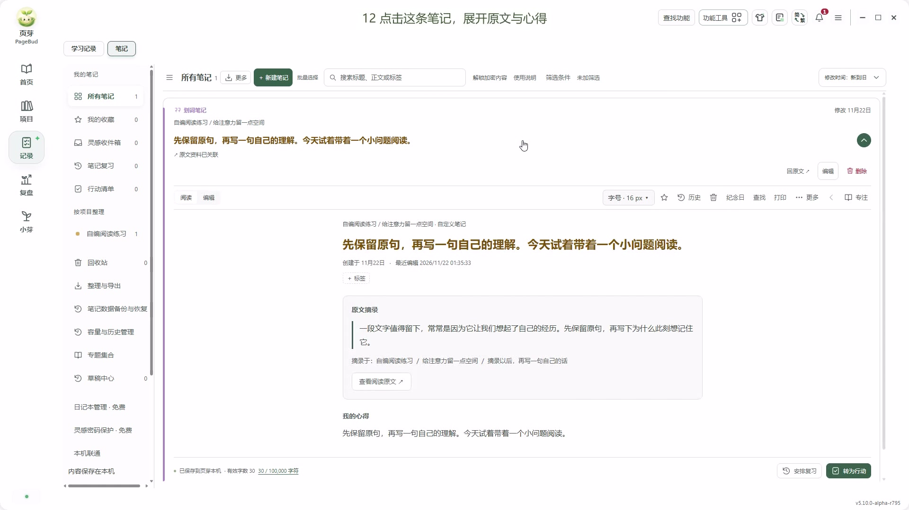

# 页芽 PageBud

页芽是一款 Windows 本地学习、规划、阅读与笔记工具。

个人发布者：nana  
联系邮箱：foxappleccc@gmail.com  
当前下载：5.10.0-alpha-r804 · Windows 64 位 · **未签名公开试用版（Pre-release）**

## 看一段实际操作

从开始学习、阅读与心得保存，到结束记录后从笔记返回原文。视频使用现有学习项目和真实书籍，完整展示操作过程，页面下方提供安装包。

https://github.com/user-attachments/assets/e6e8612c-df2a-4139-9b36-b035872af49c

## 下载安装

**[下载独立安装包（Setup，约 235 MiB）](https://github.com/nanamiyananaa-code/PageBud-Downloads/releases/download/v5.10.0-alpha-r804/PageBud-Setup-5.10.0-alpha-r804-windows-x64.exe)** · [版本与全部附件](https://github.com/nanamiyananaa-code/PageBud-Downloads/releases/tag/v5.10.0-alpha-r804)

1. 首次使用下载 `PageBud-Setup-5.10.0-alpha-r804-windows-x64.exe`，运行安装向导。
2. 已有页芽的用户可选择 [升级包](https://github.com/nanamiyananaa-code/PageBud-Downloads/releases/download/v5.10.0-alpha-r804/PageBud-Update-5.10.0-alpha-r804-windows-x64.exe)；升级前确认数据已保存，并保留独立备份。
3. [SHA256SUMS.txt](https://github.com/nanamiyananaa-code/PageBud-Downloads/releases/download/v5.10.0-alpha-r804/SHA256SUMS.txt) 提供文件校验值；可使用 PowerShell 的 `Get-FileHash -Algorithm SHA256 -LiteralPath '安装包完整路径'` 核对。

安装包支持选择程序安装位置；正常升级及标准卸载保留本地学习数据。建议先使用少量非敏感资料体验，并保留自己的独立备份。

## 教程与更新

- 核心安装包保留功能、文字教程、海报和字幕。需要视频时，在教程内点击下载；完成后可离线观看。网络不可用时仍可使用本地学习与笔记功能。
- [完整离线便携包（约 1.22 GiB）](https://github.com/nanamiyananaa-code/PageBud-Downloads/releases/download/v5.10.0-alpha-r804/PageBud-Offline-5.10.0-alpha-r804-windows-x64.zip) 包含全部教程，解压后运行页芽.exe；需要安装时运行同目录 PageBud-Setup.exe。
- r804 起启动后可检查 GitHub 公开预览版更新；设置中的“自动下载更新”默认关闭。开启后可后台下载，但安装前仍需点击确认，不会直接中断当前学习。r796 用户需先手动升级一次。
- GitHub 的网络可达性会影响下载与检查速度；当前没有另设镜像服务器。完整离线包可供网络不便的用户手动传递。

## 页芽可以用来做什么

- **安排学习并记录投入**：选择项目与阅读内容，设置本次目标，记录学习、暂停和完成情况。
- **边读边摘录**：在独立阅读器中查看目录、阅读原文，将摘录和自己的想法一起保存。
- **回看笔记与原文**：按项目整理笔记，从心得返回对应阅读内容，方便后续查阅。

## 软件界面

以下为内置教程录制中的真实界面，使用自编示例资料；截图中的项目、书籍和心得均为演示内容。画面来自教程录制时的版本，不代表最终视觉验收已经通过。点击图片可查看大图。

### 学习首页

选择项目、设置目标并开始学习，保留学习记录。

### 独立阅读器

阅读与学习计时衔接，支持目录、原文阅读和本书笔记。

### 原文摘录与心得

将原文和自己的理解放在一起，之后可返回阅读原文。

## nana 的话

嗨，我是 nana。页芽是我自己一直在用，也一直在改的学习工具，前前后后已经迭代了 **2000 多个自用版本**。

我想把学习计划、读到的内容、随手记下的想法，还有每次学习留下的记录，好好接在一起。读到有用的地方能记下来，下次想起时，也能顺着笔记回去看看。

现在把页芽分享出来，想邀请你也试一试。用着有哪里别扭，或者有什么想法，都可以来告诉我。

## 使用与支持

- 页芽面向 Windows 10/11 64 位电脑，主要提供本地学习、规划、阅读与笔记功能；教程和更新可以按需从 GitHub 下载。
- 本次公开下载免费；程序内各项免费功能、增强版与模块权益，以相应功能说明为准。
- 安装包目前**没有可信数字签名**，Windows 可能显示“未知发布者”或 SmartScreen 提示。请保留系统安全防护，可对照校验文件确认来源；如遇拦截，将提示及文件哈希发给我。
- 账户及其他联网服务的开放范围以软件内说明为准；使用问题和建议请发送至 foxappleccc@gmail.com。

## 隐私与支持

请先阅读 [当前数据处理说明](PRIVACY_DRAFT.md)、[下载与使用说明](TERMS.md) 和 [安全反馈说明](SECURITY_DRAFT.md)。报告问题时提供版本、系统、提示和复现步骤，避免发送密码、激活码、私人笔记或完整用户数据。

## 如何查看访问与下载统计

- **访问量、独立访客与来源**：发布账号登录后打开 [Insights → Traffic](https://github.com/nanamiyananaa-code/PageBud-Downloads/graphs/traffic)。GitHub提供最近14天数据；访客数据按小时更新，来源及热门页面按天更新，时间使用UTC。
- **安装包与升级包下载次数**：上方徽章分别读取当前版本附件，可能有缓存延迟；历史版本的下载次数仍保留在各自发行页，不会因更新清空。[GitHub实时附件数据](https://api.github.com/repos/nanamiyananaa-code/PageBud-Downloads/releases/tags/v5.10.0-alpha-r804)中的 `download_count` 为原始计数。
- **次数不等于人数**：重复下载、验证请求及自动访问可能影响计数；校验文件和许可ZIP没有并入安装包徽章。下载计数无法证明安装成功、独立用户数或实际使用人数。
- 如需长期访问趋势，应定期保存最近14天数据。本仓库未增加独立访问追踪器或付费统计服务；下载徽章由免费Shields.io显示。

截图和介绍可以独立更新；本版安装包及发布时的SHA256校验文件保持原样。

## 闭源与第三方许可

本仓库只放下载说明、版本信息、校验和及必要第三方材料，**不公开页芽自有源码，不含控制端**。页芽自有程序保持闭源。

ThirdParty 目录及许可附件保留依赖的原始许可和相应字体源码，第三方许可证授予的权利不受页芽声明缩减。GitHub 自动生成的 “Source code” ZIP／tar.gz 只归档此下载仓库的说明和第三方材料，不含页芽自有源码。
